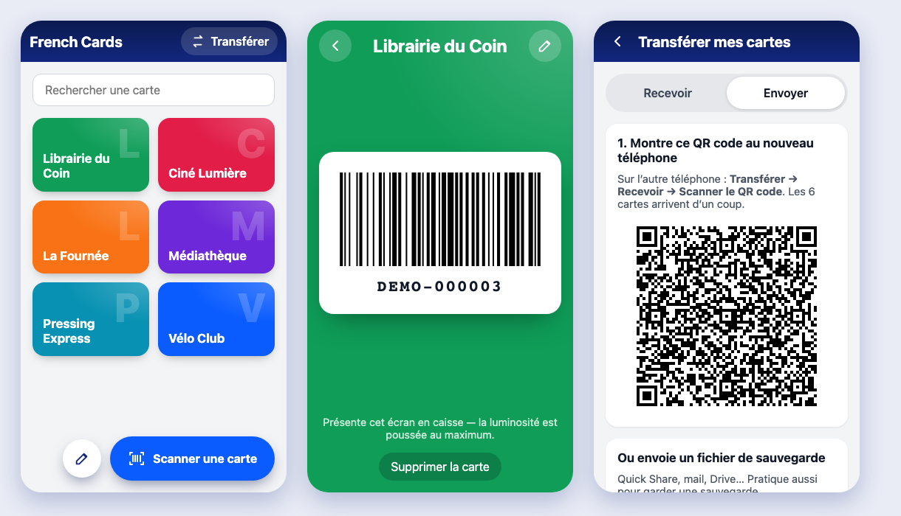

# French Cards

Toutes mes cartes de fidélité tiennent dans le téléphone. **French Cards** scanne le code-barres d'une carte,
l'affiche en plein écran avec la luminosité au maximum en caisse, et transfère toute la collection vers un nouveau
téléphone en un seul QR code.

Pas de compte, pas de serveur, pas de publicité : les cartes restent sur le téléphone.



*Captures réalisées avec des cartes fictives.*

---

## Ce que fait l'app

* **Scan** : Lecture du code-barres avec l'appareil photo (ML Kit), format détecté automatiquement.
* **Caisse** : Code-barres en grand, numéro lisible dessous, luminosité de l'écran poussée au maximum.
* **Formats** : Code 128, EAN-13, EAN-8, UPC, Code 39, ITF, QR code, Data Matrix, PDF417 et Aztec.
* **Classement** : Les cartes utilisées récemment remontent en tête, une recherche filtre par nom.

## Changer de téléphone

* **QR code** : Ancien téléphone, *Transférer → Envoyer* affiche un QR code qui contient toutes les cartes
  (compressées). Nouveau téléphone, *Scanner une carte* ou *Transférer → Recevoir*, puis viser ce QR.
* **Fichier de sauvegarde** : *Transférer → Envoyer → Partager le fichier* (Quick Share, mail, Drive), puis
  *Recevoir → Choisir le fichier*.
* **Ancienne app (v3)** : *Mode édition → Exporter les cartes → Copier*, s'envoyer le texte, puis
  *Recevoir → Coller depuis le presse-papiers*. L'ancien format JSON est relu tel quel, et une mise à jour sur le
  même téléphone migre aussi les cartes stockées par la v3.

Les doublons (même numéro de carte) sont ignorés à l'import.

## Installer l'APK

Chaque push sur `master` construit un APK signé et le publie en Release GitHub :

**https://github.com/NicolasRoehm/french-cards/releases/latest/download/french-cards.apk**

Ouvrir ce lien sur le téléphone, puis autoriser l'installation depuis le navigateur (« Sources inconnues »).
Un build manuel se lance depuis l'onglet *Actions* (`workflow_dispatch`).

---

## Développement

Angular 22 (*standalone*, *signals*, *zoneless*) + Capacitor 8 (Android). Les codes-barres sont dessinés en SVG
par bwip-js.

```bash
npm install
npm start                 # http://localhost:4200 (le scan n'existe que sur Android)
npm run sync              # build Angular + copie dans android/
npm run open:android      # Android Studio
npm run apk               # APK release en local (JDK 21 + Android SDK)
```

Live reload sur téléphone : `LIVE_RELOAD_URL=http://<ip-du-mac>:4200 npx cap run android`.

Sur macOS < 14, le binaire `sass-embedded` ne démarre pas : préfixer les builds par `NG_BUILD_SASS_EMBEDDED=0`.

## Signature

Aucune clé n'est versionnée.

* **Local** : Keystore dans `.dsh/secrets/release.jks` (gitignoré), mots de passe dans `.env` (voir
  `.env.example`). `npm run apk` lit les variables `ANDROID_*` de l'environnement (`set -a; . ./.env; set +a`)
  ou `android/keystore.properties`, sinon la clé debug.
* **CI** : Secrets GitHub `ANDROID_KEYSTORE_BASE64`, `ANDROID_KEYSTORE_PASSWORD`, `ANDROID_KEY_ALIAS`,
  `ANDROID_KEY_PASSWORD`.

Garder ce keystore : sans lui, une mise à jour de l'app installée est impossible (il faut désinstaller, donc
exporter ses cartes avant).
